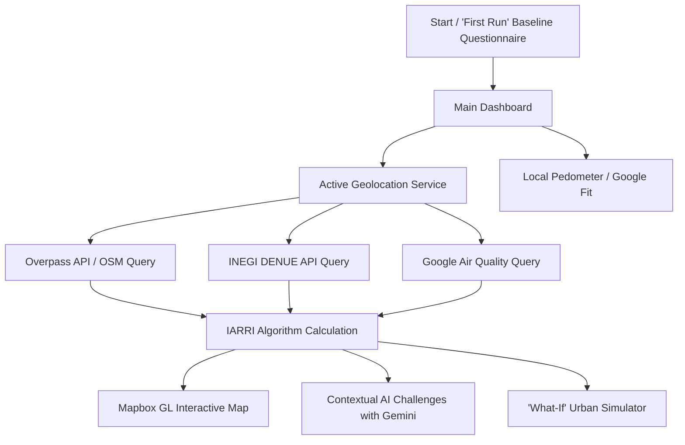

# ARQ-MX — Urban Environment & Metabolic Health

<p align="center">
  
</p>

<p align="center">
  <strong>An interactive mobile platform to assess, visualize, and simulate the impact of urban design on metabolic health.</strong>
</p>

<p align="center">
  
  
  
  
  
  
  
</p>

---

## 📑 Table of Contents

1. [About the Project](#-about-the-project)
2. [Scientific and Metabolic Foundation](#-scientific-and-metabolic-foundation)
3. [How the Application Works](#-how-the-application-works)
   - [User Flow](#user-flow)
   - [IARRI Calculation Engine](#iarri-calculation-engine)
   - [Dynamic AI-Powered Challenges](#dynamic-ai-powered-challenges)
   - [Interactive Urban Simulator](#interactive-urban-simulator)
   - [Health Metrics and Native Pedometer](#health-metrics-and-native-pedometer)
4. [Technologies and Tools](#%EF%B8%8F-technologies-and-tools)
5. [Local Installation and Setup](#-local-installation-and-setup)
   - [Prerequisites](#prerequisites)
   - [Environment Variables Configuration](#environment-variables-configuration)
   - [Running in Browser](#running-in-browser)
   - [Building and Deploying to Android](#building-and-deploying-to-android)
6. [Security and Privacy](#-security-and-privacy)

---

## 📖 About the Project

**ARQ-MX** is a cross-platform mobile and web application (Android, iOS, and Web PWA) designed to bridge the gap between **urban design** and **preventative public health**. The built environment where we live profoundly determines our daily levels of physical activity, exposure to ultra-processed foods, environmental stressors, and, ultimately, our biological health.

The application continuously analyzes the user's geographic location, evaluates surrounding infrastructure using open satellite and cartographic data (OpenStreetMap / Overpass API), official economic activity data for food outlets (INEGI DENUE), and socioeconomic marginalization indices (CONAPO), calculating a synthetic risk indicator: the **Risky Environment / Health Promoting Index (IARRI)**.

Through this platform, citizens, researchers, and urban planners can:
- Diagnose the metabolic impact of their neighborhood in real time.
- Receive contextualized mobility and habit challenges powered by **Google Gemini**.
- Use an interactive urban simulator to project how infrastructure changes (more green spaces, bike lanes, or reduced availability of ultra-processed food) reshape community metabolic risk.

---

## 🧬 Scientific and Metabolic Foundation

Unlike conventional fitness applications focused strictly on calorie counting or raw step tracking, **ARQ-MX** tackles the underlying urban determinants of non-communicable lifestyle diseases:

| Environmental Factor | Biomarker / Metabolic Impact | Function in ARQ-MX |
| :--- | :--- | :--- |
| **Green Spaces & Parks** | Cortisol reduction, sympathetic nervous system modulation, and encouragement of aerobic exercise. | Positively weighted in the index; mapped as health-promoting zones. |
| **Walkability & Connectivity** | Basal energy expenditure, improvement in non-insulin-mediated muscular glucose uptake (GLUT4). | Walk Score and pedestrian intersection density calculations. |
| **Sports Facilities** | Resistance and cardiovascular training promotion; enhanced insulin sensitivity. | Identification of public sports infrastructure relative to local population density. |
| **Food Environment (Fast Food vs. Fresh Produce)** | Visceral adiposity, postprandial glycemic spikes, and development of metabolic syndrome. | Calculation of the **Risky Food Environment (EAR)** using INEGI SCIAN economic codes. |
| **Air Quality (AQI, PM2.5, CO)** | Systemic oxidative stress, endothelial inflammation, and mitochondrial dysfunction. | Environmental monitoring with actionable alerts for outdoor workouts. |

---

## ⚙️ How the Application Works

### User Flow



1. **Baseline Profile and Assessment (`First-Run`):** Upon launching the application for the first time, users complete an evaluation of their daily mobility habits, perceived environment, and background. Data is saved locally and securely.
2. **Geolocation and Spatial Telemetry:** The `LocationService` obtains high-accuracy coordinates (GPS or network) and triggers reverse geocoding to determine neighborhood, postal code, and municipality.
3. **Urban Radius Scan:** A radial search query is executed over a zone of influence (400 m – 3 km), detecting parks, sports facilities, cycle paths, grocery stores, convenience shops, and fast-food chains.
4. **Cartographic Visualization:** Under the `Map` tab, `Mapbox GL JS` renders thematic layers with metabolically classified markers (🟢 Health-Promoting, 🔴 High-Risk, 🟡 Neutral) and density heatmaps.
5. **AI-Driven Challenges and Gamification:** The `Challenges` module queries Google Gemini with full context (live weather, time of day, IARRI score, nearest POIs) to generate hyper-personalized health missions.
6. **Scenario Simulator:** Under the `Calculator` tab, users or researchers can adjust sliders for urban variables to dynamically see how public infrastructure upgrades modify the IARRI score.

---

### IARRI Calculation Engine

The **Risky Environment / Health Promoting Index (IARRI)** synthesizes multiple dimensions of the public realm into a normalized score between `0.00` and `1.00`.

$$\text{IARRI} = \alpha(1 - \overline{AV}) + \beta(1 - \overline{IC}) + \gamma(1 - \overline{ED}) + \delta(\overline{EAR}) + \epsilon(\overline{IM})$$

#### Weights and Variables:
- **$\alpha = 0.20$ — Green Areas ($AV$):** Square meters of green space per resident normalized against WHO guidelines ($9.0\text{ m}^2/\text{inhabitant}$).
- **$\beta = 0.25$ — Walkability Index ($IC$):** Average of pedestrian intersection density, continuous sidewalks, and urban amenities.
- **$\gamma = 0.15$ — Sports Facilities ($ED$):** Proportion of accessible sports infrastructure relative to the local population.
- **$\delta = 0.25$ — Risky Food Environment ($EAR$):** Derived from INEGI's DENUE API:
  $$\text{EAR} = \frac{\text{Fast Food (SCIAN 722513)} + 0.5 \times \text{Corner Groceries (SCIAN 461110)}}{\text{Total Food Establishments}}$$
- **$\epsilon = 0.15$ — Marginalization Index ($IM$):** Official socioeconomic vulnerability data from CONAPO.

#### Risk Stratification:
- **0.00 to 0.33 (Low Risk / Protective Environment):** High green space availability, outstanding pedestrian connectivity, and rich fresh food supply.
- **0.34 to 0.66 (Medium Risk / Neutral Environment):** Moderate infrastructure with growth opportunities in active transit or food diversity.
- **0.67 to 1.00 (High Risk / Obesogenic Environment):** Food deserts or swamps dominated by ultra-processed goods, low walkability, and minimal recreational spaces.

---

### Dynamic AI-Powered Challenges

Implemented in `GeminiService`, the system leverages state-of-the-art Google Gemini models (`gemini-2.0-flash`, with automated fallback to `gemini-2.0-flash-lite` and `gemini-1.5-flash`).

Rather than displaying static, pre-written prompts, the AI receives:
- Current user IARRI classification level.
- Municipality and neighborhood.
- Live temperature, precipitation forecast, and UV index.
- Current time of day (morning, afternoon, or evening).
- Active POIs within 500 meters (e.g., *"Juarez Park 150m away"* or *"Fitness Center 300m away"*).
- Past completed challenges history to prevent repetition.

The output is structured as clean JSON containing a challenge title, educational explanation of its metabolic benefit, experience points, and estimated completion time.

---

### Interactive Urban Simulator

Located in `src/app/calculadora`, this module enables urban planners, researchers, and students to manipulate 5 independent variables via sliders:
- **Green area per inhabitant ($m^2$).**
- **Pedestrian connectivity and intersection density.**
- **Sports and fitness facility density.**
- **Ratio of ultra-processed food vendors vs. fresh markets.**
- **Degree of socioeconomic marginalization.**

The engine recalculates the score in real time and offers targeted intervention recommendations to curb metabolic syndrome risk.

---

### Health Metrics and Native Pedometer

The `HealthService` module provides a dual-mode tracking architecture:
1. **Google Fitness API:** Aggregated daily step count queries (`com.google.step_count.delta`).
2. **Inertial Hardware Sensor Pedometer:** For offline or non-OAuth environments, it utilizes the native hardware motion API (`DeviceMotionEvent` / 3-axis accelerometer), identifying stride vectors with acceleration differential thresholds between $2.0\text{ m/s}^2$ and $15.0\text{ m/s}^2$, and automatically computing active calories burned.

---

## 🛠️ Technologies and Tools

### Core & Frontend
- **[Ionic Framework v8](https://ionicframework.com/):** Native-feeling UI components for iOS and Android with automatic Light/Dark mode support.
- **[Angular v20](https://angular.dev/):** Reactive architecture built with TypeScript, RxJS, modular dependency injection, and route guards (`FirstRunGuard`).
- **[SCSS / Sass](https://sass-lang.com/):** Scalable styling system with custom CSS variables tailored for mobile screens.

### Native Mobile Layer (Capacitor v8)
- `@capacitor/core` & `@capacitor/android`: Native Android compilation bridge.
- `@capacitor/geolocation` & `@capacitor-community/background-geolocation`: Foreground GPS and background geofencing.
- `@capacitor/motion`: Accelerometer access for the on-device pedometer.
- `@capacitor/local-notifications` & `@capacitor/haptics`: Immediate geofence notifications and tactile feedback.

### Geospatial Services & Open Data
- **[Mapbox GL JS v3.20](https://www.mapbox.com/mapbox-gljs):** GPU WebGL-accelerated vector map rendering.
- **[Overpass API / OpenStreetMap](https://wiki.openstreetmap.org/wiki/Overpass_API):** Real-time spatial queries for urban nodes and infrastructure polygons.
- **[INEGI DENUE API](https://www.inegi.org.mx/servicios/api_denue.html):** National Statistical Directory of Economic Units (metric radius and coordinate queries).
- **CONAPO:** Official municipal marginalization geostatistical data.

### Artificial Intelligence & Cloud
- **[Google Generative AI SDK (`@google/generative-ai`)](https://ai.google.dev/):** Integration with Google Gemini (Gemini 2.0 Flash / 1.5 Flash).
- **[Google Air Quality API](https://developers.google.com/maps/documentation/air-quality):** Real-time air quality index and pollutant monitoring (AQI, PM2.5, CO).
- **[Google Fitness API](https://developers.google.com/fit):** Aggregated step and health telemetry queries.
- **[Open-Meteo API](https://open-meteo.com/):** Free meteorological endpoint for environmental and challenge context.

---

## 🚀 Local Installation and Setup

### Prerequisites

Ensure you have the following installed on your workstation:
- **[Node.js](https://nodejs.org/)** (v18.x or higher)
- **[npm](https://www.npmjs.com/)** (bundled with Node.js)
- **[Ionic CLI](https://ionicframework.com/docs/intro/cli)**:
  ```bash
  npm install -g @ionic/cli
  ```
- *(Optional for Android builds)*: **[Android Studio](https://developer.android.com/studio)** with Android SDK Platform 34+ and Java JDK 17+.

---

### Environment Variables Configuration

The repository includes a template file at [src/environments/environment.example.ts](file:///c:/Users/Eyzen%207%205700x/Downloads/Mobile%20App%20ARQ-MX/src/environments/environment.example.ts). Create your environment configuration files by running:

```bash
# On Windows (PowerShell):
Copy-Item src/environments/environment.example.ts src/environments/environment.ts
Copy-Item src/environments/environment.example.ts src/environments/environment.prod.ts

# On Linux / macOS / Bash:
cp src/environments/environment.example.ts src/environments/environment.ts
cp src/environments/environment.example.ts src/environments/environment.prod.ts
```

Open `src/environments/environment.ts` and set your credentials:

```typescript
export const environment = {
  production: false,
  
  // 1. INEGI DENUE API: Food business economic units queries
  // Get your free API token at: https://www.inegi.org.mx/servicios/api_denue.html
  inegiKey: 'YOUR_INEGI_DENUE_API_KEY',
  
  // 2. Mapbox Public Access Token (pk.ey...)
  // Sign up at: https://account.mapbox.com/
  mapboxKey: 'pk.eyJ1IjoieW91ci11c2VyIiwiYSI6InlvdXItdG9rZW4ifQ.xyz',
  
  // 3. Google Gemini API Key (AIzaSy...)
  // Obtain your key in Google AI Studio: https://aistudio.google.com/
  geminiKey: 'AIzaSyXXXXXXXXXXXXXXXXXXXXXXXXXXXXX',
  
  // 4. Google Cloud Platform API Key (Optional for Air Quality & Fitness)
  // Google Cloud Console: https://console.cloud.google.com/
  googleApiKey: 'YOUR_GOOGLE_CLOUD_API_KEY'
};
```

---

### Running in Browser

To launch the local development server with Live Reload:

```bash
ionic serve
# Or alternatively:
npm start
```

The application will automatically open in your default browser at `http://localhost:8100/`.

> **💡 Browser Geolocation Testing Tip:** Open Developer Tools (`F12`), navigate to the *Sensors* tab, and simulate coordinates for any city to see POIs and IARRI metrics dynamically recalculate.

---

### Building and Deploying to Android

To bundle and run the native application on an Android device or emulator:

1. **Build the production web bundle:**
   ```bash
   npm run build
   ```

2. **Sync web assets and native plugins with Capacitor:**
   ```bash
   npx cap sync android
   ```

3. **Open the project in Android Studio:**
   ```bash
   npx cap open android
   ```

4. From Android Studio, click **Run** (`Shift + F10`) with your physical device connected via USB debugging or using an AVD emulator.

---

## 🔒 Security and Privacy

- **Local Storage Privacy:** Questionnaire responses and step history remain stored strictly on-device (`localStorage`), without transmission to third-party servers without consent.
- **Credential Protection:** The files `environment.ts` and `environment.prod.ts` are excluded from version control via `.gitignore` to prevent secret leakage.
- **Transient Location Usage:** Geolocation coordinates are evaluated in-memory solely for spatial health analysis and are never logged or stored in external persistent databases.

---